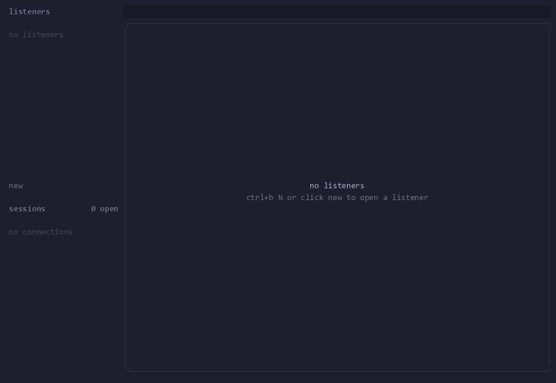

# outpost



**a terminal multiplexer for network listeners.**

open listeners on any `ip:port`, watch connections arrive, and talk back to
each one. it's a [herdr](https://github.com/herdrdev/herdr)-inspired `nc -l`, but for many listeners and many peers at once, in one
window.

- **tcp, udp, tls, and quic.** tls and quic generate a self-signed certificate
  on the fly, or use your own pem files. set alpn for clients that need it.
- **every connection is a tab.** each peer gets its own transcript and input
  line. udp peers are split by address, and quic streams are tagged so you can
  pick which one to write to.
- **mouse and keyboard.** click, right-click, and scroll, or use tmux-style
  `ctrl+b` prefix keys.
- **one rust binary.** runs in whatever terminal you already use.

## install

from a checkout:

```bash
cargo install --path .
```

## usage

```bash
outpost
```

press `ctrl+b N` (or click **new**) and pick a protocol, address, and port.
connections show up as tabs: type a line and press `enter` to send it.

| key            | action                   |
| -------------- | ------------------------ |
| `ctrl+b N`     | new listener             |
| `ctrl+b s`     | listener settings        |
| `ctrl+b j / k` | next / previous listener |
| `ctrl+b n / p` | next / previous tab      |
| `ctrl+b X`     | close tab (disconnects)  |
| `ctrl+b D`     | close listener           |
| `ctrl+b ?`     | all keybindings          |
| `ctrl+b q`     | quit                     |

right-click a listener or tab to rename or close it.
